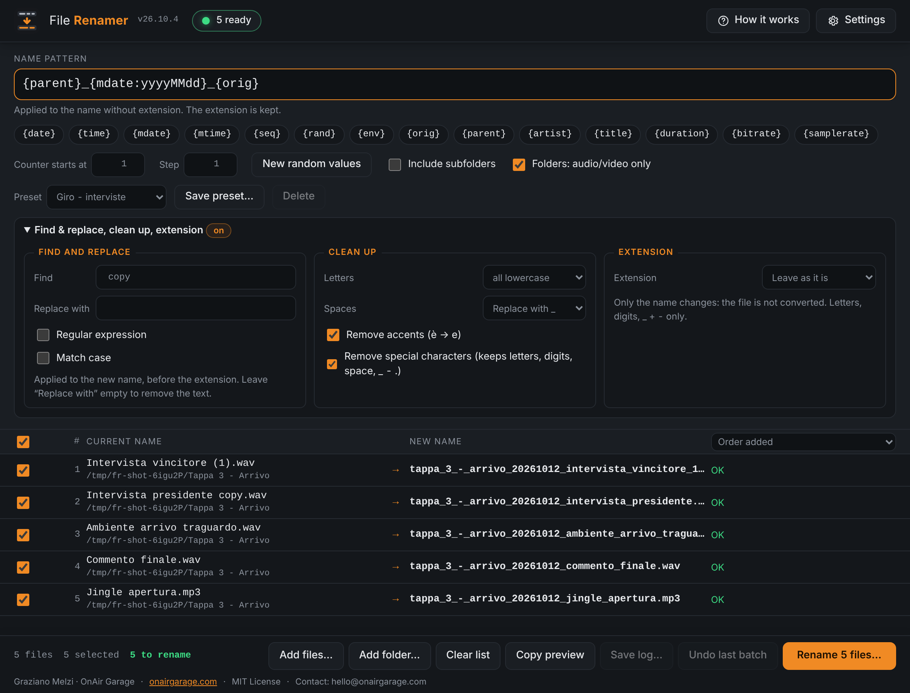

# File Renamer

Batch rename audio and video files with a pattern, a mandatory preview and one-step undo. Free desktop app (Electron) from [OnAir Garage](https://onairgarage.com).

- Tool page: https://onairgarage.com/tools/file-renamer/
- Author: Graziano Melzi · OnAir Garage — hello@onairgarage.com
- License: MIT (see `LICENSE`)
- Systems: Windows (installer), macOS (dmg, Apple silicon and Intel), Linux (AppImage, x64)

## What it does

Drop files or folders on the list, write a pattern such as `{date:yyyyMMdd}_{seq:3}_{orig}`, check the **New name** column and confirm. Nothing is renamed before you confirm, and an existing file is never overwritten.

- One row per file with a checkbox, current name → new name, and a status. Names and paths are monospace.
- The pattern applies to the name without extension; the extension is kept.
- The counter `{seq}` follows the order of the list and starts where you say (start and step fields).
- Problems (empty name, reserved name, duplicate in the batch, name already on disk) turn the row red and block the rename until you fix the pattern or uncheck the row.
- "Undo last batch" restores the names of the newest batch; press it again to go back one more (the last 10 batches are kept). A batch that can no longer be undone can be forgotten to reach the one before.
- Languages: English (default, the app always opens in English), Italiano, Español; the choice is remembered. Theme: light, dark or follow the system.
- **Tags and file values**: `{artist}`, `{title}`, `{duration}`, `{bitrate}`, `{samplerate}` are read from the file itself (see the placeholder table); a file without the tag gets an empty value and its row says "tag missing".
- **Extension** (optional): keep it, lowercase, UPPERCASE or replace it. Only the name changes: the file is not converted.
- **Copy preview** (clipboard: `old name → new name`, one line per file that would be renamed) and **Save log…** (CSV of the last batch: old name, new name, folder, result, time; the files that failed too).
- **Sort** the list by order added, name, modified date or size before the counter `{seq}` is applied.
- **Find & replace and clean up** (optional, applied to the new name after the pattern): find plain text or a regular expression and replace it (empty = remove); remove accents and special characters, lowercase / UPPERCASE / Title Case, spaces to `_` or `-`.
- **Presets**: pattern, counter, find & replace and clean up saved under a name (up to 50).
- **Settings** in tabs (General, Updates, Backup, Help & About). **Backup**: export / import of settings and presets (`file-renamer-backup-YYYY-MM-DD.json`; the app keeps no passwords or tokens).
- **Guided update**: banner with *Download and install*, *Remind me later*, *Skip this version*; progress bar; download verified against `SHA256SUMS.txt`; *Close and install* (refused while a rename runs; a safety copy of the settings is saved first); a *What's new* window after the update. Optional, switchable in Settings → Updates; nothing is installed without a click.
- **Help & About**: licence, credits, links, *Copy info for support* (no file names or folders) and *Open logs folder* (daily logs, 7 days, counts only).



### Placeholders

Same meaning as in G-Downloader (re-implemented, not copied), plus `{orig}`, `{parent}` and the values read from the file.

| Placeholder | Meaning |
|---|---|
| `{date}` / `{date:FORMAT}` | Current date, default `yyyy-MM-dd` |
| `{time}` / `{time:FORMAT}` | Current time, default `HHmmss` |
| `{mdate}` / `{mtime}` | Same as `{date}` / `{time}` (same FORMAT and shifts) but the file's own modification time |
| `{date+1h:H}`, `{date-1d:yyyyMMdd}` | Shifted by N minutes (`m`), hours (`h`) or days (`d`) |
| `{seq}` / `{seq:N}` | Counter of the batch, zero-padded to N digits |
| `{rand}` / `{rand:N}` | Random lowercase letters and digits (default 6, max 64) |
| `{env:NAME}` | Value of the environment variable `NAME` (empty if unset) |
| `{orig}` | Original name without extension |
| `{parent}` | Name of the folder that contains the file |
| `{artist}` / `{title}` | Tags read from the file (ID3, Vorbis comments, MP4, RIFF INFO, APE…); several artists are joined with `/` (which becomes `_` in a name). Empty when the file has none |
| `{duration}` / `{duration:mmss}` / `{duration:hhmmss}` | Length in whole seconds (`187`), minutes and seconds (`0307`), hours, minutes and seconds (`000307`) |
| `{bitrate}` / `{samplerate}` | Bit rate in kbit/s (rounded) and sample rate in Hz, as written in the file |

FORMAT letters (own implementation, not date-fns): `yyyy yy MM M dd d HH H hh h mm m ss s SSS a`; text in single quotes is literal. Unknown `{words}` are kept as typed and flagged. Random values are seeded, so the preview does not flicker while you type; "New random values" draws a new set. The names you confirm are exactly the names shown.

## Formulas and sources

There are no measurements or standards-based formulas. The only external rules are the file naming rules below.

| Value / rule | Source | Status |
|---|---|---|
| Characters not allowed in a name: `< > : " / \ \|  ? *` and control characters 0–31 | Microsoft Learn, *Naming Files, Paths, and Namespaces* (Naming Conventions) | **official** (read) |
| Reserved names `CON PRN AUX NUL COM1–9 LPT1–9` (and `COM¹ ² ³`, `LPT¹ ² ³`), also followed by an extension | same page | **official** (read) |
| A name must not end with a space or a period | same page | **official** (read) |
| Names longer than 255 characters are refused | no single source: most common file systems allow 255 characters or bytes per name | **recommended** (cautious choice, counts UTF-16 units) |
| Placeholder syntax (`{date:FORMAT}`, `{seq:N}`…) | G-Downloader `src/templates.js` (own project) | reference implementation |

The Windows rules are applied on every system so that names also work after moving files to Windows or to an exFAT/FAT drive. Forbidden characters are replaced by `_` (the row says so); reserved names are refused.

## Assumptions and limits

- Only regular files are renamed. Folders, symbolic links and (when scanning folders) hidden files are skipped.
- `{date}` and `{time}` are the moment of the preview; `{mdate}` and `{mtime}` are the modification time of each file (in the time zone of the computer). The creation date is not offered: it is not available on every system and file system.
- Never overwrite: the new name is first claimed with a hard link (fails if the name is taken) and the old name is removed afterwards. On file systems without hard links (FAT, exFAT, some network shares) the app falls back to "check, then rename", which leaves a very small time window.
- Swaps and chains inside a batch (a→b while b→c) and case-only changes (`Clip.wav` → `clip.wav`) go through temporary names (`.fr-<random>.tmp`, same folder).
- The undo history keeps the last 10 batches (and at most 100,000 files in all), in the app data folder of the user (`undo-history.json`; the single batch kept by 26.10.3 in `last-batch.json` is picked up as the first one). A file whose size or modification time changed since the rename, or whose old name is now used by another file, is not touched by the undo. Batches are undone newest first.
- The app never writes tags or file contents. Tags, lengths, bit rates and sample rates are only read (library `music-metadata`, JavaScript, on the computer; nothing is sent anywhere), and only when the pattern uses one of them; the answers are remembered while the app is open and read again if the file changes. A file that cannot be read, or has no such tag, gives an empty value ("tag missing"). The length comes from the file headers: for an MP3 without a VBR header it is an estimate. A file that takes more than 10 seconds to read is given up.
- The extension option changes the name only: an `.wav` renamed to `.mp3` is still a WAV file. The new extension may contain letters, digits, `_`, `+` and `-` (16 at most); two files that end up with the same name are blocked as duplicates.
- The CSV log opens in Excel, Numbers and LibreOffice (UTF-8 with BOM, comma-separated). A cell that starts with `=`, `+`, `-` or `@` gets a leading `'` so that a spreadsheet does not read a file name as a formula.
- Find & replace with a regular expression uses the JavaScript engine of the app; a very heavy expression on thousands of files can make the preview slow. An invalid expression blocks the rename and says so. The clean-up rule "special characters" keeps letters, digits, space and `_ - .` and removes everything else.
- Settings and presets are in `settings.json` in the app data folder; the values saved by 26.10.1 in the window are copied there at the first start.

## Install

- **Windows**: run the installer; SmartScreen may say "Windows protected your PC" (*More info → Run anyway*).
- **macOS**: open the disk image, drag the app to Applications. The app is signed ad hoc (no Apple account): the first start says "unidentified developer"; open *System Settings → Privacy & Security*, scroll down and click *Open Anyway*. From 26.10.4 on an Apple Silicon Mac no longer says the app is "damaged" (it did up to 26.10.3). **Second method**, in Terminal, which also opens an earlier version that says "damaged": `xattr -cr "/Applications/File Renamer.app" && codesign --force --deep -s - "/Applications/File Renamer.app"`.
- **Linux**: make the AppImage executable and run it.

## Validation and references

Results as of 2026-10-23 on Linux (a cloud container, Node 22, Electron under a virtual screen); the 26.10.1 results were on macOS (APFS). This is not a certified tool.

| Reference | What it validates | Result | How to re-run |
|---|---|---|---|
| `dev/pattern.test.js` (expected strings written by hand) | dates, formats, shifts, counter, random determinism, `{env}`, `{orig}`, unknown placeholders | 8 tests pass (Linux) | `npm test` |
| `dev/planner.test.js` on temporary folders | sanitizing and reserved names (Microsoft rules), counter order, duplicates, existing file, swap, cycle, chain, case-only change, missing source, undo (changed file, occupied name) | 14 tests pass (Linux) | `npm test` |
| `dev/features.test.js` | find & replace (plain, regex, groups, bad expression), clean up, `{parent}`, find / clean in the plan and the safety rules after them, settings and presets, backup (export, replace, add-only, refusals), logs rotation, the same texts in en / it / es, icons, no inline script | 19 tests pass (Linux) | `npm test` |
| `dev/guided.test.js` (fake GitHub) | release lookup, installer of this system, foreign URLs never followed, SHA-256 check, interrupted download, remind later / skip, safety copy, install plan, what's new from the packaged CHANGELOG | 5 tests pass (Linux) | `npm test` |
| `dev/updater.test.js` (fake GitHub, temporary folders) | verified download gets its real name; wrong checksum, network error, cancel, stall and a failed rename leave no `.part`; `.part` files left by an earlier run are swept at start | 8 tests pass (Linux) | `npm test` |
| `dev/tip.test.js` | tip line text in en / it / es, link to the site page in the app language, only the site and this project's GitHub open from the app, the jar image ships with the app | 2 tests pass (Linux) | `npm test` |
| `dev/metadata.test.js` (WAV and MP3 files built by `dev/fixtures.js`) | the five placeholders and their formats, empty values, the reader on real files (RIFF INFO and ID3v2 tags, no tags, a text file, a missing file), memory of answers, at most 6 files at once, a slow file given up, "tag missing" in the plan, a failing reader | 10 tests pass (Linux) | `npm test` |
| `dev/batches.test.js` | extension (options, plan, duplicates, existing file, presets, settings, backup), CSV (quotes, BOM, formula cells), undo history (10 batches, limits, migration of `last-batch.json`, damaged file, two batches undone one after the other, forgetting a blocked batch), sort by size | 16 tests pass (Linux) | `npm test` |
| `dev/release.test.js` | ad-hoc signature hook wired (the signature itself runs only on a Mac), macOS first-start texts in en / it / es, the release-notes link goes to the site page in the language of the app, same keys in the three languages, every element the script uses exists, preload and main agree on every channel | 9 tests pass (Linux) | `npm test` |
| `dev/e2e-electron.mjs` (real app, DevTools protocol) | preload + IPC: folder scan with filter, plan with `{env}`, rename on disk, refusal of invalid names, undo, find / clean / `{parent}`, tags and extension through the real app (music-metadata inside Electron), two batches undone in turn, forgetting a blocked batch, migration of `last-batch.json`, settings file, the window with files dropped (sort by size, extension, tags in the preview, copy preview, rename, log button, undo dialog), Settings dialog and its tabs, support info without file names, logs without file names | passes (Linux, virtual screen) | `node dev/e2e-electron.mjs` (on a server: `FR_E2E_NO_SANDBOX=1 xvfb-run -a node dev/e2e-electron.mjs`) |

**Not validated:** the ad-hoc signature of the macOS apps (the build checks it on the Mac runner; whether an installed app from the DMG opens on a clean Apple Silicon Mac must be tried by hand); tag reading on files from real recorders, encoders and libraries (the tests use a WAV and an MP3 built on the fly; FLAC, M4A, Ogg, AIFF and the other formats are read by the library and were not tried here), the length of VBR MP3 files without a header; *Save log…* opened in Excel / Numbers / LibreOffice; *Copy preview* pasted into other programs on Windows and macOS; Linux on a real desktop (the AppImage and its *Close and install*); exFAT/FAT and network drives (hard-link fallback path); case-sensitive APFS volumes; very long names on each file system. Windows and macOS (installers, *Close and install*, the interface, auto-update, drag & drop from the file manager) have been tried by hand by the author (declared 17 October 2026); no independent implementation was used for the date formatter.

## Sources to re-check

Last read on 2026-10-01:

| Document | Version read |
|---|---|
| Microsoft Learn, *Naming Files, Paths, and Namespaces* — https://learn.microsoft.com/en-us/windows/win32/fileio/naming-a-file | page updated 2025-04-11 |

## Run locally

Needs Node.js 22+.

```bash
npm install
npm start          # run the app
npm test           # unit tests (Node test runner)
node dev/e2e-electron.mjs   # end-to-end check of the real app
npm run dist:mac   # or dist:win / dist:linux — installers in release/
```

`python3 dev/serve.py` and then http://127.0.0.1:8765/preview shows the real interface in a normal browser with the fake backend of `dev/mock-api.js`, for looking at layout only. `dev/make-screenshots.mjs` takes the screenshots from the real app (made-up file names); `dev/make-icons.mjs` generates every icon from `assets/logo.svg`.

Release files must be uploaded to a GitHub release together with a `SHA256SUMS.txt` (`name` on each line, SHA-256 first). The update check expects these names: `File-Renamer-Setup-<version>.exe`, `File-Renamer-<version>-arm64.dmg` / `File-Renamer-<version>-x64.dmg`, `File-Renamer-<version>.AppImage`.

## Structure

- `main.js`, `preload.cjs` — Electron main process and the bridge to the window.
- `src/pattern.js` — placeholder engine. `src/planner.js` — names, sanitizing, collisions. `src/renamer.js` — rename without overwrite, undo log. `src/undo-history.js` — the last 10 batches. `src/metadata.js` — tags and file values (music-metadata). `src/csv.js` — CSV log. `src/updater.js` — update check, verified download, safety copy, what's new.
- `renderer/` — interface (strict CSP, no inline script or style, no external resources).
- `src/text-tools.js` — find & replace, clean up, extension. `src/settings.js` — settings file and presets. `src/backup.js`, `src/logger.js`, `src/updater.js` — shared OnAir Garage modules (header `// garage-common: <name> <version>`).
- `assets/` — logo (`logo.svg`) and icons (`dev/make-icons.mjs` regenerates them).
- `dev/` — tests and tools; `dev/sign-adhoc.cjs` signs the macOS app ad hoc during the build (electron-builder `afterPack`).

Versions are `YY.M.N` (e.g. `26.10.1`), tags `v26.10.1`. The version lives in `package.json`; keep README and release notes in line with it.

## Credits

No third-party fonts. One library at run time: `music-metadata` (MIT, and its small dependencies, all MIT) reads the tags. Build tools: Electron and electron-builder (MIT).
